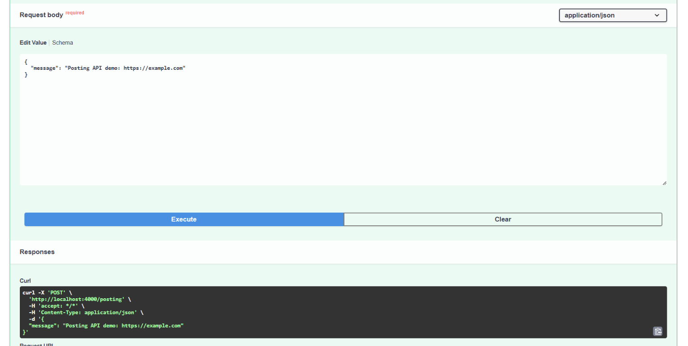
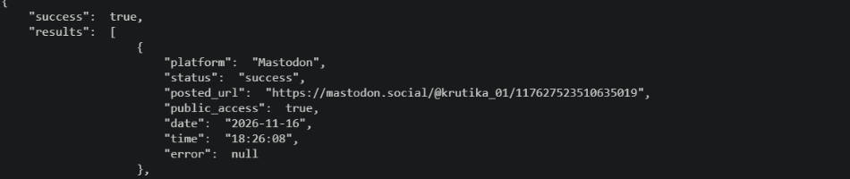
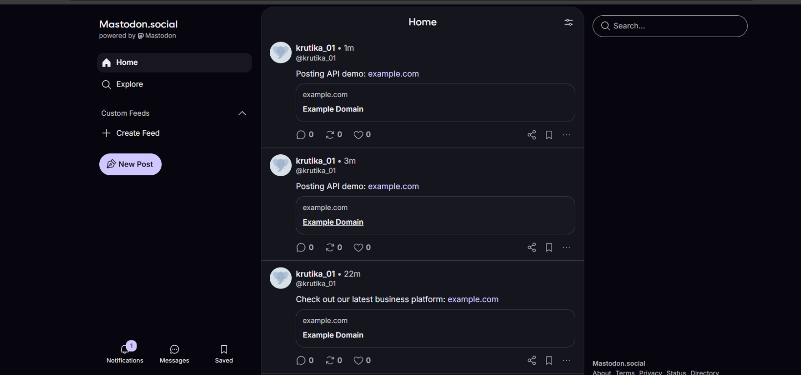
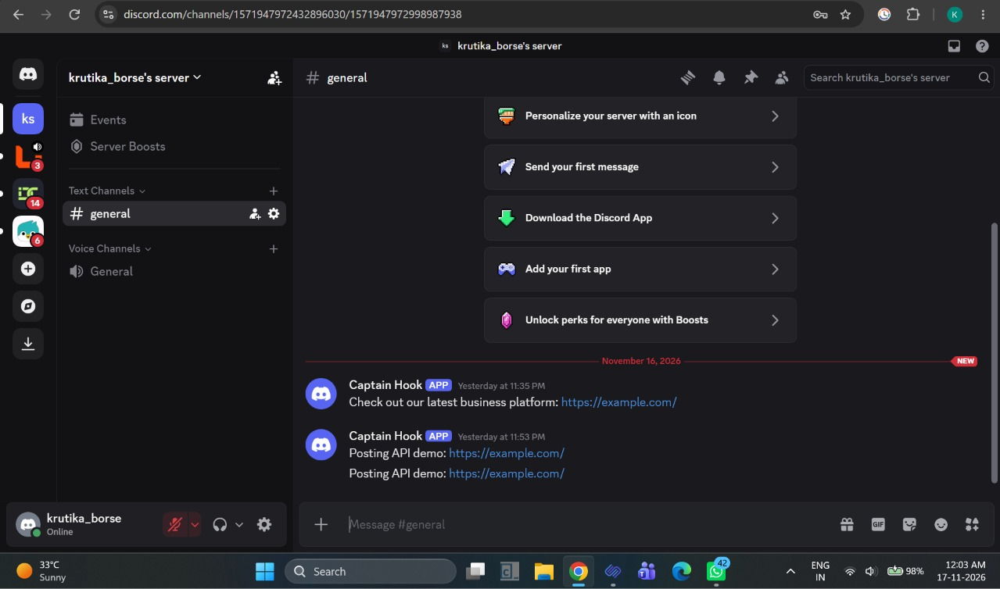

# Automated Multi-Platform Posting API

A small FastAPI service that publishes one short update to five platforms:

- Mastodon
- Bluesky
- DEV Community
- Telegram
- Discord

These are social and messaging platforms; this project does not integrate an
LLM platform.

Each platform is configured with environment variables. A platform without
credentials is reported as failed while the remaining platforms are still
attempted.

## Requirements

- Python 3.10 or newer
- API credentials for the platforms you want to use

## Run locally

```powershell
python -m venv .venv
.\.venv\Scripts\Activate.ps1
python -m pip install -r requirements.txt
Copy-Item .env.example .env
# Edit .env and add credentials for one or more platforms.
uvicorn app.main:app --host 0.0.0.0 --port 4000
```

Interactive API documentation is available at
<http://localhost:4000/docs>.

## Request

`POST /posting` accepts one message with exactly one HTTP or HTTPS link. The
message, including the link, must be no longer than 200 characters. Other
links, including bare domains, are rejected. Bluesky posts include a rich-text
facet so the CTA is clickable.

```powershell
Invoke-RestMethod `
  -Uri http://localhost:4000/posting `
  -Method Post `
  -ContentType "application/json" `
  -Body '{"message":"Check out our latest business platform: https://example.com"}'
```

## Response

```json
{
  "success": true,
  "results": [
    {
      "platform": "Mastodon",
      "status": "success",
      "posted_url": "https://mastodon.social/@account/123",
      "public_access": true,
      "date": "2026-11-16",
      "time": "10:30:00",
      "error": null
    },
    {
      "platform": "DEV Community",
      "status": "failed",
      "posted_url": null,
      "public_access": false,
      "date": null,
      "time": null,
      "error": "DEVTO_API_KEY is not configured"
    }
  ]
}
```

`success` is true when at least one platform accepts the post. A successful
Telegram post can have no public URL because Telegram private chats do not
provide one. Times are UTC.

`public_access` describes visibility reported by the platform, not an
anonymous access check. It is conservative: `false` also means public access
could not be confirmed. Mastodon uses the returned status visibility; Telegram
public channels and supergroups with a username get a `t.me` link. DEV
Community is reported as public when its API confirms publication. Discord
webhook responses do not establish channel permissions, so those results are
reported as `false`.

## Proof of working

A live request was sent to `POST /posting` with the message
`Posting API demo: https://example.com`. Mastodon and Discord accepted the
post. Bluesky, Reddit and Telegram were intentionally left unconfigured, so they
were reported as failed without stopping the other platforms. This recording
predates the replacement of Reddit with DEV Community.

### Swagger UI request (`http://localhost:4000/docs`)



### Uvicorn running and JSON response with `posted_url`



Full response: [docs/proof/posting-response.json](docs/proof/posting-response.json)

```json
{
  "success": true,
  "results": [
    {
      "platform": "Mastodon",
      "status": "success",
      "posted_url": "https://mastodon.social/@krutika_01/117627523510635019",
      "public_access": true,
      "date": "2026-11-16",
      "time": "18:26:08",
      "error": null
    },
    {
      "platform": "Discord",
      "status": "success",
      "posted_url": "https://discord.com/channels/1571947972998987938/1571954547298144266",
      "public_access": true,
      "date": "2026-11-16",
      "time": "18:26:09",
      "error": null
    }
  ]
}
```

The response also contains `failed` entries for the unconfigured platforms
(see the full JSON file).
This is a historical response, recorded before public-access reporting and
Discord message links were corrected.

### Mastodon post



### Discord message



### Latest live check

On 17 November 2026, a live request using `Posting API demo:
https://example.com` returned success for all five platforms. The DEV and
Mastodon posts were reachable without signing in; the Bluesky post and its
link facet were checked through the public API.

- [Sanitized results log](docs/proof/latest-posting-results.txt)
- [Mastodon post](https://mastodon.social/@krutika_01/117632053988717752)
- [Bluesky post](https://bsky.app/profile/kr-ut.bsky.social/post/3n2j62ywzxf2n)
- [DEV Community article](https://dev.to/krutika_borse_864ff6bfe5e/posting-api-demo-46o4)
- [Discord message](https://discord.com/channels/1571947972432896030/1571947972998987938/1572244508542771353)

The Telegram message was sent to a private destination, so no public post URL
was returned. Discord access depends on channel permissions.

## Platform setup

Copy `.env.example` to `.env`. Only set credentials for platforms you intend
to use. Do not commit `.env` or access tokens.

For DEV Community, generate an API key in Settings > Extensions > DEV Community
API Keys and set `DEVTO_API_KEY` in `.env`. Each message is published as an
article, with a title derived from the text and the full message as its body.
Follow DEV Community's rules, especially when posting promotional content.

Official API references:

- [Mastodon REST API](https://docs.joinmastodon.org/methods/statuses/)
- [Bluesky create session](https://docs.bsky.app/docs/api/com-atproto-server-create-session)
- [Bluesky create record](https://docs.bsky.app/docs/api/com-atproto-repo-create-record)
- [Bluesky links and rich text](https://bsky.network/docs/about-bluesky-content/post-richtext/)
- [DEV Community article API](https://developers.forem.com/api/v1#tag/articles/operation/createArticle)
- [Telegram Bot API sendMessage](https://core.telegram.org/bots/api#sendmessage)
- [Discord execute webhook](https://discord.com/developers/docs/resources/webhook#execute-webhook)

## Test

```powershell
python -m pytest
```

The tests mock platform behavior, so they do not publish anything externally.
